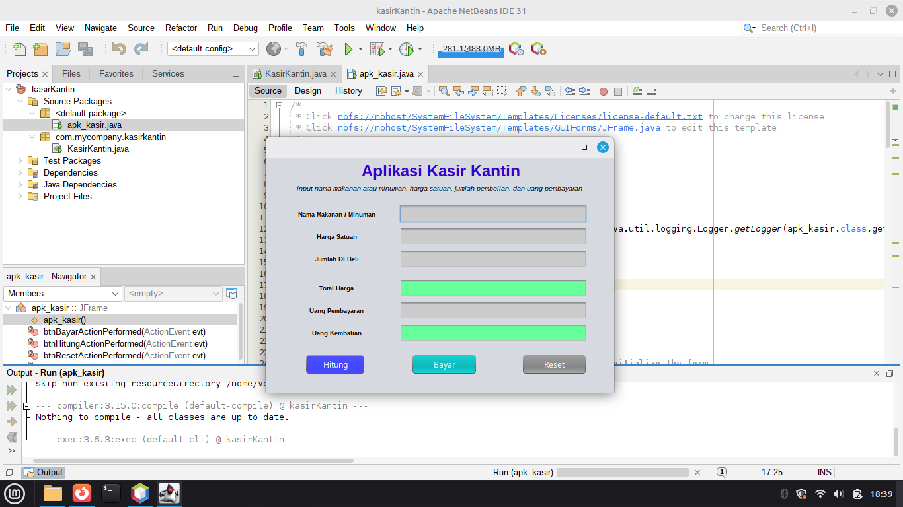
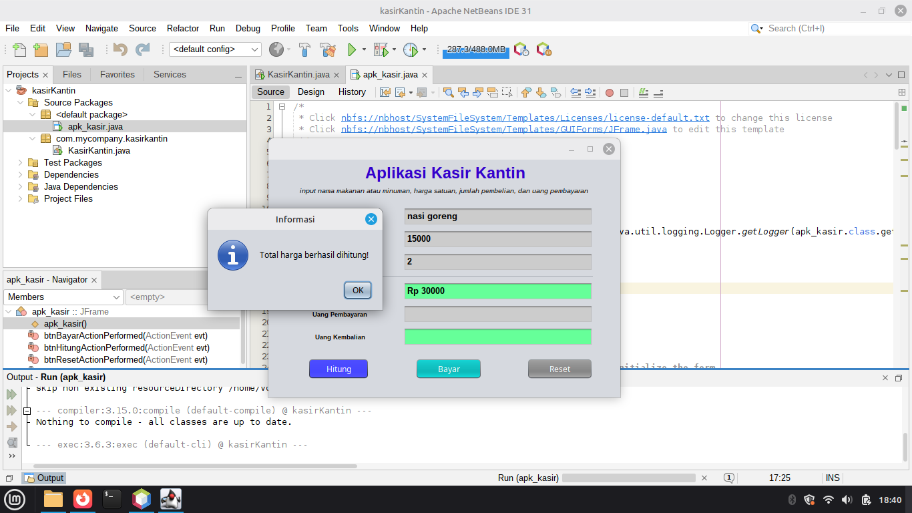
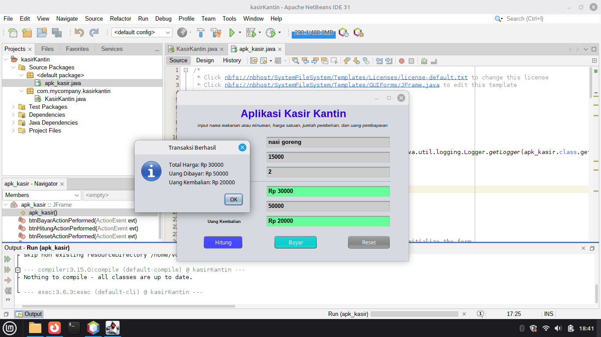
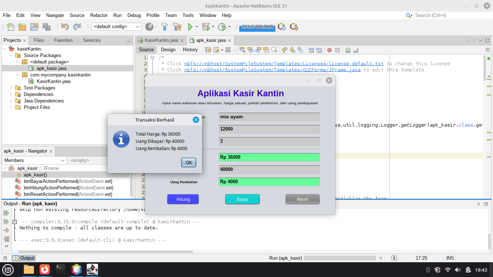
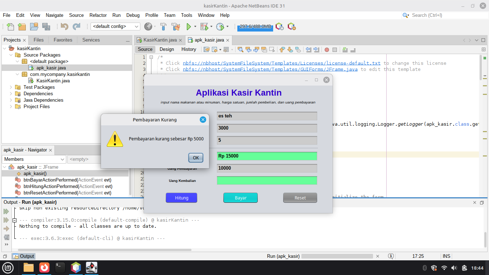
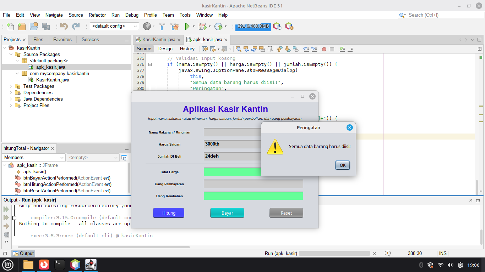
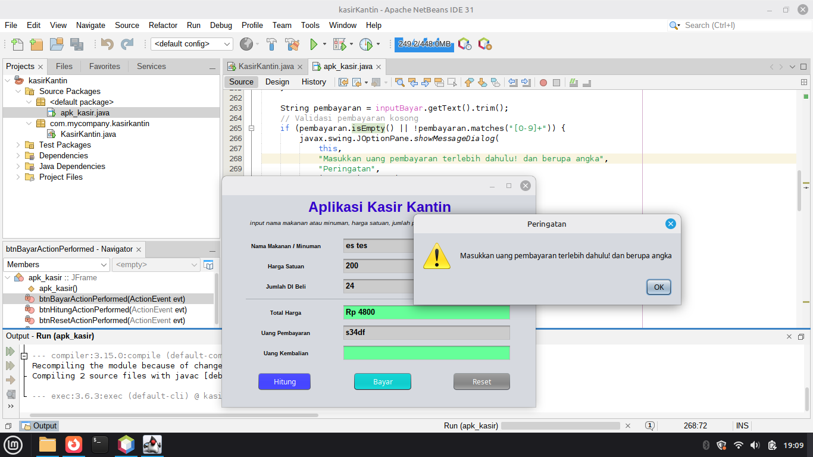
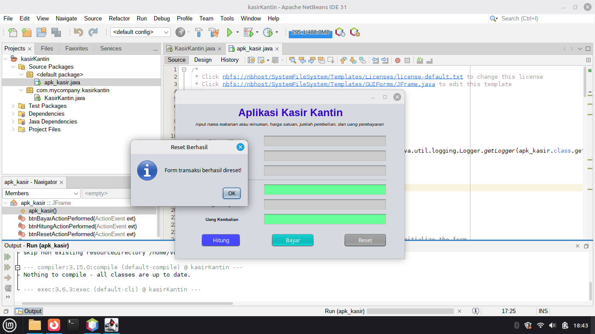

# Kasir Kantin Kampus

**Nama:** Aris Riswanto  
**NIM:** C2483207002
**Kelas:** PTI5A
**Program Studi:** Pendidikan Teknologi Informasi  
**Universitas:** Universitas Muhammadiyah Tasikmalaya (UMTAS)
**Mata Kuliah:** Pemrograman Visual
**Tema Proyek:** aplikasi kasir

UTS Pemrograman Visual — Program Studi Pendidikan Teknologi Informasi, FKIP Universitas Muhammadiyah Tasikmalaya, Tahun Akademik 2026/2027 Ganjil.

## Deskripsi Singkat

Aplikasi desktop berbasis **Java Swing** untuk membantu petugas kantin kampus mencatat satu jenis makanan atau minuman dalam setiap transaksi, menghitung total harga, menerima pembayaran, menghitung kembalian. Aplikasi memberi peringatan yang jelas ketika input tidak valid atau uang pembayaran kurang.

## Fitur

- Input nama makanan/minuman, harga satuan, jumlah pembelian, dan uang pembayaran.
- Tombol **Hitung**: menampilkan total harga (`Harga Satuan × Jumlah Pembelian`).
- Tombol **Bayar**: menampilkan uang kembalian (`Uang Pembayaran − Total Harga`).
- Tombol **Reset**: mengosongkan seluruh input dan hasil.
- Validasi input dengan pesan yang jelas:
  - input wajib belum diisi;
  - kolom angka berisi karakter yang bukan angka termasuk -56 (negatif) jadi nanti tidak bisa kalau ada angka yang negatif karena ada karakter yang bukan angka;
  - uang pembayaran lebih kecil daripada total harga (ditampilkan jumlah kekurangannya).
- Setelah terjadi kesalahan, akan ada peringatan.

## Komponen Java Swing yang Digunakan

| Komponen     | Kegunaan                                                                |
| ------------ | ----------------------------------------------------------------------- |
| `JFrame`     | Jendela utama aplikasi (`KasirKantinFrame`)                             |
| `JPanel`     | Wadah tata letak (`GridBagLayout`) dan wadah tombol                     |
| `JLabel`     | Judul, label kolom input/hasil, dan pesan status                        |
| `JTextField` | Input data dan tampilan hasil (total dan kembalian, tidak dapat diedit) |
| `JButton`    | Tombol Hitung, Bayar, dan Reset                                         |
| `JSeparator` | Pemisah antara bagian input dan pembayaran                              |

## Petunjuk Menjalankan Aplikasi

**Prasyarat:** JDK 17 atau lebih baru dan Apache NetBeans IDE.

1. Clone repository ini atau unduh isinya:
   ```
   git clone https://github.com/jangaris/UTS-Pemrograman-Visual-C2483207002.git
   ```
2. Buka Apache NetBeans, pilih **File → Open Project**, lalu pilih folder `UTS-Pemrograman-Visual-C2483207002`.
3. Klik kanan pada proyek **apk_kasir**, pilih **Run** atau tekan **F6**.
   Kelas utama: `kasirkantin.Main`.

## Pengujian Aplikasi

### 1. Tampilan Utama



### 2. Hasil Perhitungan Total (Nasi Goreng, tombol Hitung)



### 3. Hasil Pembayaran dan Uang Kembalian



### 4. Pengujian Mie Ayam



### 5. Pengujian Es Teh



### 6. Validasi: Harga dan Jumlah beli Bukan Angka


### 7. Validasi: Nama, Harga, Jumlah Beli Kosong



### 8. Validasi: pembayaran bukan angka atau Kosong



### 9. Setelah Tombol Reset


